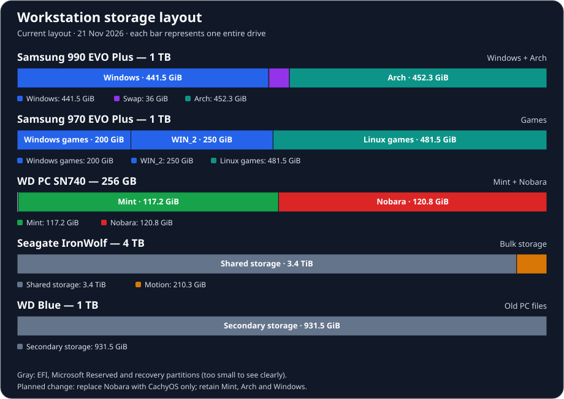

# Partition Layout

Verified 2026-11-21 using Arch Linux, Nobara, Linux Mint, Windows Disk Management and owner confirmation. Five internal drives and 17 partitions. Removable BIOS USB excluded.

Device names are taken from the Arch session and may change between boots. Identify partitions by physical drive model and locally recorded UUID/PARTUUID before making changes.

## Storage overview



Each bar represents the full capacity of a drive; the bars are normalized independently. Small EFI, reserved and recovery partitions remain listed in the detailed table below.

## Physical drives

| Device | Model | Type | Reported size | Nominal capacity | Firmware |
| --- | --- | --- | --- | --- | --- |
| sda | Seagate IronWolf ST4000VN008-2DR166 | SATA HDD, 5980 RPM | 3.6 TiB | 4 TB | SC60 |
| sdb | WD Blue WD10EZEX-08WN4A0 | SATA CMR HDD, 7200 RPM | 931.5 GiB | 1 TB | 02.01A02 |
| nvme0n1 | Samsung 970 EVO Plus | NVMe 1.3 SSD | 931.5 GiB | 1 TB | 4B2QEXM7 |
| nvme1n1 | Samsung 990 EVO Plus | NVMe 2.0 SSD | 931.5 GiB | 1 TB | 1B2QKXG7 |
| nvme2n1 | WD PC SN740 SDDPNQD-256G-2006 | NVMe 1.4 SSD | 238.5 GiB | 256 GB | HPS1 |

Both HDDs are 3.5-inch SATA 6 Gb/s drives with 512-byte logical and 4096-byte physical sectors. All three NVMe drives report a formatted 512-byte LBA size.

## Partitions

A dash means no filesystem or label was reported.

| Partition | Size | Filesystem | Label | GPT partition type | Purpose |
| --- | --- | --- | --- | --- | --- |
| sda1 | 16 MiB | — | — | Microsoft reserved | Windows reserved space |
| sda2 | 3.4 TiB | NTFS | Storage | Microsoft basic data | Main shared storage |
| sda3 | 210.3 GiB | ext4 | — | Linux filesystem | Motion surveillance recordings; created to resolve NTFS recording issues |
| sdb1 | 16 MiB | — | — | Microsoft reserved | Windows reserved space |
| sdb2 | 931.5 GiB | NTFS | — | Microsoft basic data | Secondary storage and old PC files |
| nvme0n1p1 | 200 GiB | NTFS | WIN_GAMES | Microsoft basic data | Windows games |
| nvme0n1p2 | 250 GiB | NTFS | WIN_2 | Microsoft basic data | Additional Windows games |
| nvme0n1p3 | 481.5 GiB | ext4 | LINUX_GAMES | Linux filesystem | Dedicated Linux Steam library |
| nvme1n1p1 | 100 MiB | FAT32 | — | EFI System | Main shared EFI: Mint GRUB and Windows Boot Manager; also mounted by Arch |
| nvme1n1p2 | 16 MiB | — | — | Microsoft reserved | Windows reserved space |
| nvme1n1p3 | 441.5 GiB | NTFS | — | Microsoft basic data | Windows 11 system, page file and crash dump |
| nvme1n1p4 | 880 MiB | NTFS | — | Windows recovery environment | Windows recovery |
| nvme1n1p5 | 36 GiB | swap | — | Linux swap | Dedicated Arch swap; appears as a primary partition in Windows |
| nvme1n1p6 | 452.3 GiB | ext4 | — | Linux root (x86-64) | Arch Linux root |
| nvme2n1p1 | 512 MiB | FAT32 | — | EFI System | Nobara EFI; Fedora-named UEFI loader |
| nvme2n1p2 | 117.2 GiB | ext4 | — | Linux filesystem | Linux Mint root |
| nvme2n1p3 | 120.8 GiB | ext4 | nobara-root | Linux filesystem | Nobara root; intended CachyOS replacement |

## Mount points by operating system

Partition names in this table use the Arch-session reference mapping above, even where the running OS enumerates the NVMe drives differently.

| Partition / resource | Arch | Mint | Nobara |
| --- | --- | --- | --- |
| sda2 | /mnt/storageHDD4TB (ntfs3) | /media/skrynat/Storage (ntfs-3g) | Not mounted |
| sda3 | Not mounted | /mnt/linux-storage | Not mounted |
| sdb2 | Not mounted | Mounted under /media/skrynat/ during inspection; not in fstab | Not mounted |
| nvme0n1p1 | Not mounted | /mnt/samsung970/win_games (ntfs-3g) | Not mounted |
| nvme0n1p3 | Not mounted | /mnt/samsung970/linux_games (noatime) | /games/linux (noatime) |
| nvme1n1p1 | /boot/efi | /boot/efi | Not mounted |
| nvme1n1p5 | Active swap | Not active | Not active |
| nvme1n1p6 | / | Not mounted | Not mounted |
| nvme2n1p1 | Not mounted | Not mounted | /boot/efi |
| nvme2n1p2 | Not mounted | / | Not mounted |
| nvme2n1p3 | Not mounted | Not mounted | / |
| Swap file | — | /swapfile (2 GiB) | — |
| ZRAM | — | — | zram0 (8 GiB) |
| RAM-backed /tmp | — | — | Configured in fstab |

Mint and Nobara identify persistent disk mounts by UUID. Arch uses UUIDs for its root, EFI and swap, but currently references /dev/sda2 directly for shared storage. The Samsung 970 and 990 exchanged NVMe device numbers between Arch and the Mint/Nobara sessions.

## Bootloader summary

| UEFI entry | Loader | Physical EFI partition |
| --- | --- | --- |
| 0002 — ubuntu (default) | EFI/ubuntu/shimx64.efi | Samsung 990, 100 MiB |
| 0000 — Windows Boot Manager | EFI/Microsoft/Boot/bootmgfw.efi | Samsung 990, 100 MiB |
| 0003 — Fedora | EFI/fedora/shimx64.efi | WD SN740, 512 MiB |

Mint owns the master GRUB menu. Custom entries are maintained in /etc/grub.d/09_custom; Mint, Arch and Nobara are booted by directly loading their kernel and initramfs files, while Windows is chainloaded. GRUB default is Mint, timeout is 10 seconds, os-prober is disabled, submenus are disabled and the configured font is terminus32.pf2. The removable Kingston boot entry is excluded from the permanent inventory.

## SMART health baseline

Snapshot: 2026-11-21. All five drives reported PASSED. This is a point-in-time assessment, not a guarantee against future failure.

| Drive | Power-on hours | Temperature | Endurance used | Host writes | Host reads | SMART result |
| --- | --- | --- | --- | --- | --- | --- |
| Seagate IronWolf | 31,307 | 30°C | — | ~10.34 TB | ~5.08 TB | Passed |
| WD Blue | 20,126 | 33°C | — | Not reported | Not reported | Passed |
| Samsung 970 EVO Plus | 5,642 | 37°C | 1% | 19.7 TB | 40.1 TB | Passed |
| Samsung 990 EVO Plus | 7,582 | 38°C | 3% | 24.0 TB | 15.2 TB | Passed |
| WD SN740 | 5,533 | 23°C | 0% | 3.69 TB | 1.93 TB | Passed |

IronWolf traffic totals are approximate, calculated from reported LBA counters using 512-byte logical sectors.

- Both HDDs: zero reallocated, pending and offline uncorrectable sectors; zero UDMA CRC errors; no logged SMART errors.
- IronWolf: 21 recorded short self-tests completed without error; newest recorded at 25,194 power-on hours.
- WD Blue: no self-tests logged.
- All NVMe drives: 100% available spare, zero critical warnings and zero media/data integrity errors.
- Samsung 970 and 990: zero error information log entries; no self-tests logged.
- WD SN740: five cumulative error information log entries, no errors in displayed log, and one completed short self-test without error.
- No extended self-test was performed during this inventory.

## Operating-system roles

| OS | Role |
| --- | --- |
| Nobara → CachyOS (planned) | Daily workstation, Linux gaming and multimedia |
| Arch Linux | Independent experimental and learning environment |
| Linux Mint | Reliable fallback, recovery environment and master GRUB |
| Windows 11 | Occasional Windows-specific software and gaming |

Keep Arch, Mint and Windows installed during and after the planned CachyOS migration. No broader storage reorganization is currently planned.

## Migration boundary

Only the WD SN740 120.8 GiB Nobara root is intended for replacement by CachyOS, after backup and target verification. Preserve all other partitions, including both EFI partitions and the Linux Steam library. Prefer independent swap/ZRAM for CachyOS rather than modifying Arch's existing swap.

## Read-only verification commands

```bash
lsblk -o NAME,MODEL,SIZE,TYPE,FSTYPE,LABEL,PARTTYPE,PARTTYPENAME,UUID,PARTUUID,MOUNTPOINTS
findmnt --real
cat /etc/fstab
swapon --show
sudo efibootmgr -v
sudo smartctl -a /dev/DEVICE
```

Keep the complete UUID/PARTUUID inventory and original SMART reports locally. Public documentation intentionally omits serial numbers, WWNs, unique partition identifiers and raw private configuration.
